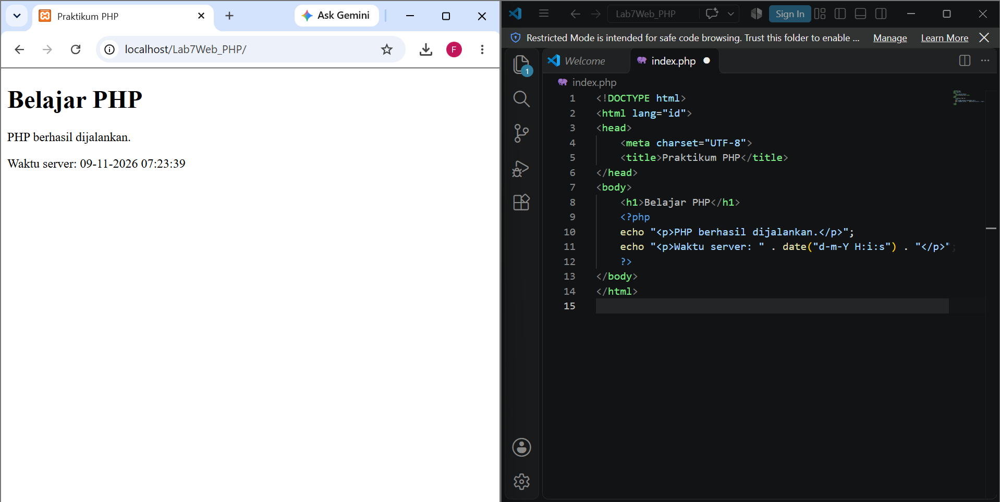
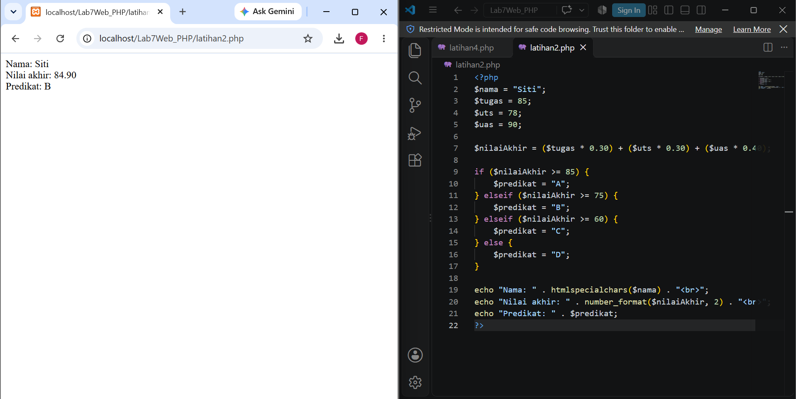
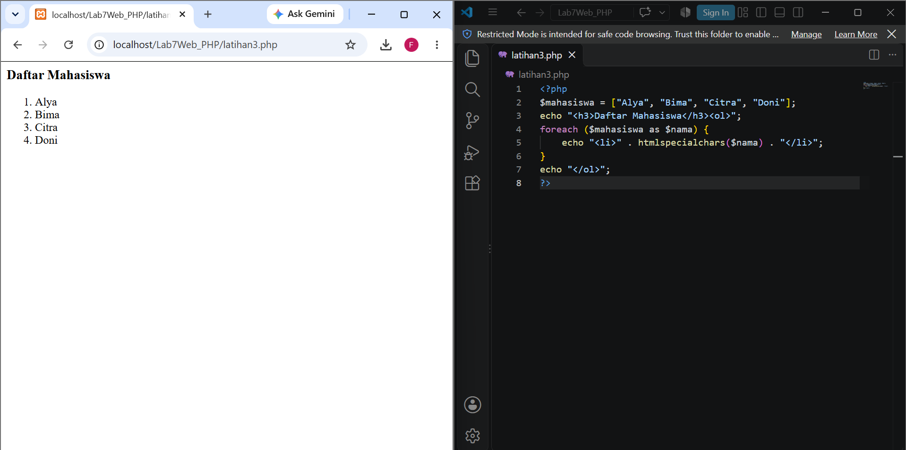
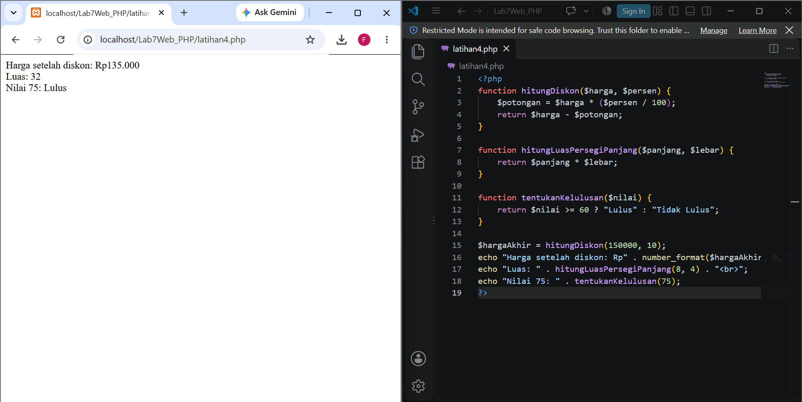
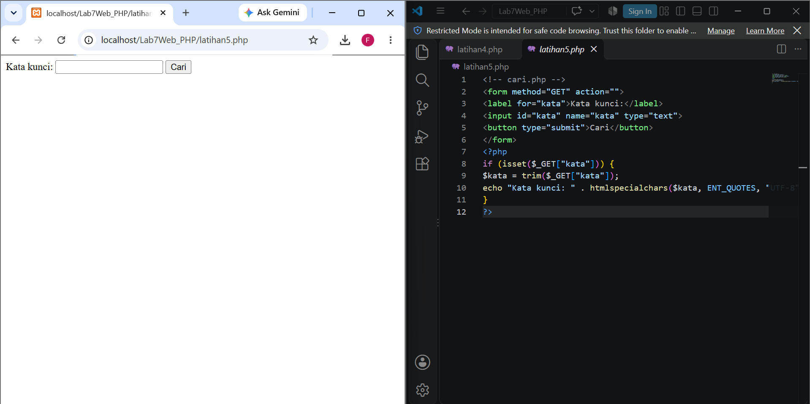
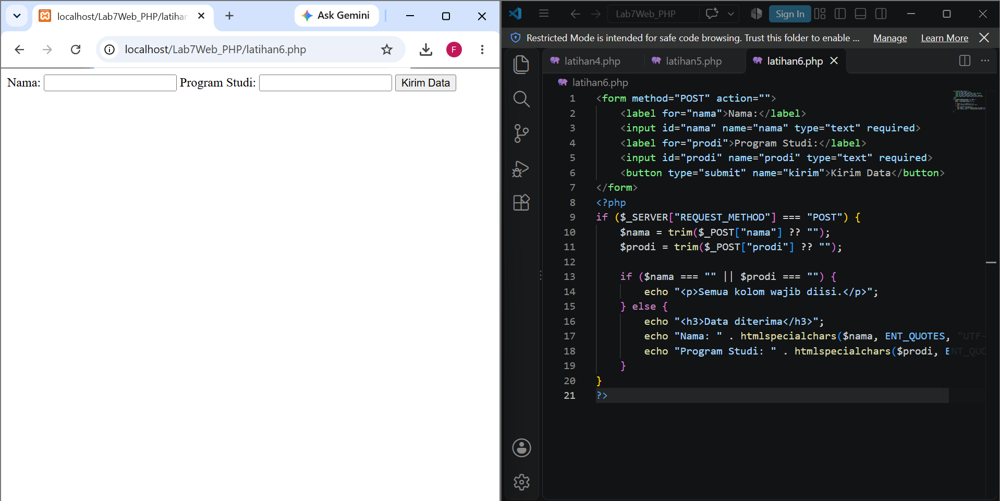
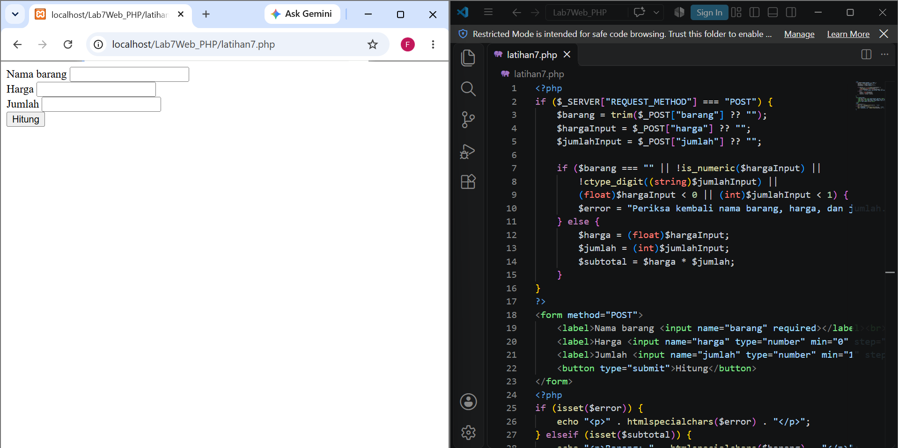
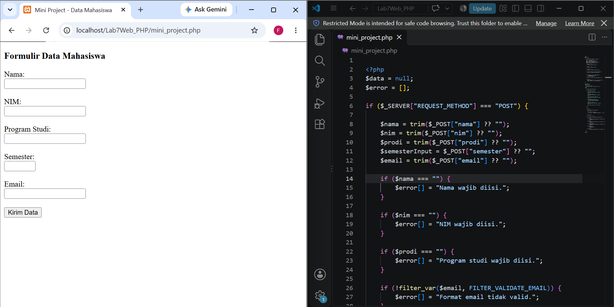

# Lab7Web_PHP — Praktikum 7: Pemrograman Server-Side dengan PHP

| | |
|---|---|
| **Mata Kuliah** | Pemrograman Web |
| **Nama** | Febryvia Deya Nur Havidtar Murti Aqsa |
| **NIM** | 312510194 |
| **Kelas** | I251B |
| **Program Studi** | Teknik Informatika |

Pertemuan 9

## Tujuan Praktikum
- Memahami perbedaan pemrosesan client-side dan server-side.
- Mengenali sintaks PHP dan menjalankan file PHP melalui server lokal.
- Menggunakan variabel, tipe data, operator, percabangan, perulangan, dan function.
- Menerima dan memproses data form HTML dengan metode GET dan POST.
- Melakukan validasi dan sanitasi input dasar sebelum data ditampilkan.
- Membangun aplikasi sederhana yang menerima, memproses, dan menampilkan data pengguna.

## Perangkat yang Digunakan
- Laptop/PC dan browser Google Chrome
- Visual Studio Code
- XAMPP v3.3.0 (Apache 2.4.58, PHP 8.0.30)

## Cara Menjalankan Server Lokal
1. Buka XAMPP Control Panel, lalu klik **Start** pada modul **Apache** (port 80 dan 443).
2. Letakkan folder `Lab7Web_PHP` di `C:\xampp\htdocs\`.
3. Buka browser dan akses `http://localhost/Lab7Web_PHP/` diikuti nama file, contoh `http://localhost/Lab7Web_PHP/latihan2.php`.
4. File PHP tidak boleh dibuka dengan klik ganda karena harus diproses oleh server.

## Struktur File
| File | Keterangan |
|------|------------|
| `index.php` | Latihan 1: Menjalankan PHP |
| `latihan2.php` | Latihan 2: Variabel, operator, percabangan |
| `latihan3.php` | Latihan 3: Perulangan dan array |
| `latihan4.php` | Latihan 4: Function |
| `latihan5.php` | Latihan 5: Form GET |
| `latihan6.php` | Latihan 6: Form POST |
| `latihan7.php` | Latihan 7: Pengolahan data sederhana |
| `mini_project.php` | Mini Project: Formulir Data Mahasiswa |
| `eksperimen mandiri.php` | Eksperimen Mandiri |
| `screenshots/` | Screenshot hasil praktikum |
| `README.md` | Laporan praktikum |

## Ringkasan Hasil

### Latihan 1 — Menjalankan PHP
Halaman menampilkan judul "Belajar PHP", teks "PHP berhasil dijalankan", dan waktu server dari fungsi `date()`. Kode PHP tidak tampil sebagai teks di browser, artinya server sudah memproses kodenya dan hanya mengirim hasil HTML.

### Latihan 2 — Variabel, Operator, dan Percabangan
Nilai akhir dihitung dengan bobot tugas 30%, UTS 30%, dan UAS 40%. Percabangan `if-elseif-else` menentukan predikat: A (≥ 85), B (≥ 75), C (≥ 60), selain itu D. Dengan tugas 85, UTS 78, dan UAS 90, nilai akhirnya **84,90** dengan predikat **B**.

Percobaan:

**Eksperimen:** bobot diubah menjadi tugas 40%, UTS 20%, UAS 40% dengan nilai tugas 89, UTS 98, UAS 96. Hasilnya nilai akhir **93,60** dengan predikat **A**.

.php.png>)

### Latihan 3 — Perulangan dan Array
Array `$mahasiswa` ditampilkan dengan `foreach` dalam bentuk list bernomor. Ditambahkan 3 nama baru (Yuri, Milo, Hiro) sehingga total 7 nama, dan `count()` dipakai untuk menampilkan jumlahnya.

Percobaan:

.php.png>)

### Latihan 4 — Function
Dibuat tiga function: `hitungDiskon()`, `hitungLuasPersegiPanjang()`, dan `tentukanKelulusan()`. Hasilnya:
- Harga Rp150.000 dengan diskon 10% menjadi **Rp135.000**.
- Luas persegi panjang 8 × 4 = **32**.
- Nilai 75 berstatus **Lulus**.

Percobaan:

### Latihan 5 — Form GET
Kata kunci dikirim lewat URL. Setelah form dikirim, alamat berubah menjadi `latihan5.php?kata=AIUEO` dan kata kunci ditampilkan kembali memakai `htmlspecialchars()`. Ini menunjukkan GET mengirim data lewat URL sehingga tidak cocok untuk data sensitif seperti kata sandi.

Percobaan:

### Latihan 6 — Form POST
Data nama dan program studi dikirim lewat body request. Server memakai `trim()` dan memeriksa apakah kolom kosong; jika lengkap, data ditampilkan kembali dengan `htmlspecialchars()`. Hasil pengujian: Nama "Febryvia Deya Nur" dan Program Studi "Teknik Informatika" tampil pada bagian "Data Diterima".

Percobaan:

### Latihan 7 — Pengolahan Data Sederhana
Form menerima nama barang, harga, dan jumlah. PHP memvalidasi input (nama tidak kosong, harga berupa angka tidak negatif, jumlah bilangan bulat minimal 1), lalu menghitung subtotal = harga × jumlah. Hasil pengujian: barang Buku, harga Rp19, jumlah 4, subtotal **Rp76**.

Percobaan:

### Mini Project — Formulir Data Mahasiswa
Form berisi nama, NIM, program studi, semester, dan email, dikirim dengan metode POST. Validasi di sisi server: semua kolom wajib diisi, semester berupa bilangan bulat dalam rentang yang ditentukan, dan email berformat valid (`filter_var` dengan `FILTER_VALIDATE_EMAIL`). Semua pesan error dikumpulkan dalam array `$error` dan ditampilkan sekaligus. Jika valid, ringkasan data ditampilkan dengan `htmlspecialchars()`.

**Kasus input valid**

| No | Input | Hasil |
|----|-------|-------|
| 1 | Nama: Febryvia Deya Nur, NIM: 312510194, Prodi: Teknik Informatika, Semester: 3, Email: febryviadeyanur@gmail.com | "Data Mahasiswa Berhasil Dikirim" beserta seluruh data |

## Eksperimen Mandiri
File: `eksperimen mandiri.php`

Eksperimen mandiri dilakukan untuk mengembangkan latihan yang telah dikerjakan sebelumnya.
1. Menghitung nilai rata-rata: menghitung rata-rata dari tiga komponen nilai, yaitu tugas, UTS, dan UAS.
2. Pencarian nama menggunakan GET: mencari nama mahasiswa dari array sederhana menggunakan in_array().
3. Function format Rupiah: membuat function untuk mengubah angka menjadi format mata uang Rupiah menggunakan number_format().
4. Validasi NIM: memeriksa agar NIM hanya berisi angka dan memiliki panjang 9 digit. Ketentuan panjang ini ditetapkan sebagai contoh pada eksperimen.
5. Tombol Reset: menambahkan tombol reset pada form untuk mengembalikan kolom input ke nilai awal.

Percobaan:

1. **Rata-rata nilai:** function `hitungRataRata()` menjumlahkan tiga nilai lalu membaginya 3. Tugas 85, UTS 78, UAS 90 menghasilkan **84,33**.
2. **Pencarian nama dengan GET:** nama disimpan dalam array dan dicari dengan `foreach` dan `stripos()` (tidak membedakan huruf besar/kecil). Pencarian "Alya" menampilkan "Ditemukan 1 nama: Alya".
3. **Format Rupiah:** function `formatRupiah()` memakai `number_format()`. Angka 1250000 menjadi **Rp1.250.000** dan 75000 menjadi **Rp75.000**.

## Pertanyaan Evaluasi

**1. Apa perbedaan pemrosesan client-side dan server-side?**

Pemrosesan client-side adalah proses yang berjalan di sisi pengguna, yaitu di dalam browser. Teknologi yang dipakai antara lain HTML untuk struktur halaman, CSS untuk tampilan, dan JavaScript untuk interaksi. Karena dijalankan di perangkat pengguna, hasilnya bisa langsung terlihat tanpa harus meminta data baru ke server. 

Pemrosesan server-side adalah proses yang berjalan di komputer server. Server menerima permintaan dari browser, mengolah input, menjalankan aturan atau logika aplikasi, lalu mengirimkan hasilnya kembali ke browser. Pada PHP, browser tidak pernah menerima kode PHP aslinya. Browser hanya menerima keluaran akhirnya, misalnya dokumen HTML. Hal ini membuat kode PHP dan logika pemrosesan tidak ditampilkan langsung kepada pengguna melalui browser.

**2. Mengapa file PHP harus dijalankan melalui web server?**

PHP adalah bahasa yang kodenya harus diterjemahkan dan dieksekusi oleh interpreter PHP di sisi server. Browser tidak punya kemampuan itu. Web server seperti Apache (pada XAMPP) berperan menerima permintaan, menyerahkan file `.php` ke interpreter, lalu mengirim hasil eksekusinya ke browser.

Jika file PHP dibuka langsung dengan klik ganda (alamat `file://`), tidak ada server yang memprosesnya. Akibatnya kode PHP tidak dijalankan dan hanya tampil sebagai teks biasa. Itulah sebabnya file harus diakses lewat alamat lokal seperti `http://localhost/Lab7Web_PHP/`.

**3. Apa fungsi tanda $ pada variabel PHP?**

Tanda `$` adalah penanda bahwa sebuah nama merupakan variabel di PHP. Setiap variabel wajib diawali `$`, misalnya `$nama`, `$umur`, dan `$nilaiAkhir`. Dengan tanda ini, PHP dapat membedakan variabel dari kata kunci, nama function, maupun konstanta. Perlu diingat juga bahwa nama variabel bersifat *case-sensitive*, sehingga `$nama` dan `$Nama` dianggap dua variabel yang berbeda.

**4. Apa perbedaan metode GET dan POST?**

Metode GET mengirim data melalui parameter pada URL, contohnya `latihan5.php?kata=AIUEO`. Karena data terlihat di alamat, GET cocok untuk permintaan yang hanya mengambil atau mencari data dan tidak mengubah apa pun, seperti fitur pencarian. GET tidak boleh dipakai untuk data sensitif seperti kata sandi karena datanya tampak di URL dan tersimpan di riwayat browser.

Metode POST mengirim data di dalam body permintaan sehingga tidak muncul di URL. POST lazim dipakai untuk pengiriman form, terutama yang menyimpan atau mengubah data. Meski begitu, POST bukan enkripsi. Untuk melindungi data selama pengiriman, koneksi tetap harus memakai HTTPS.

**5. Mengapa input pengguna perlu divalidasi di sisi server?**

Validasi di browser, seperti atribut `required` atau tipe input `number`, hanya berfungsi membantu pengguna mengisi form dengan benar. Pemeriksaan ini dapat dilewati, misalnya dengan mengubah kode HTML melalui Inspect Element atau mengirim permintaan langsung ke server.

Karena itu, server tidak boleh langsung mempercayai data yang masuk. Validasi di sisi server diperlukan untuk memastikan data tidak kosong, formatnya benar, dan nilainya sesuai dengan ketentuan aplikasi. Dengan validasi, aplikasi dapat mengurangi risiko menerima data yang salah atau tidak sesuai. Selain itu, keamanan data juga perlu didukung dengan langkah perlindungan lain, seperti penggunaan `htmlspecialchars()` ketika menampilkan input pengguna.

**6. Apa fungsi `htmlspecialchars()` ketika menampilkan data dari form?**

`htmlspecialchars()` mengubah karakter khusus HTML, yaitu `<`, `>`, `&`, tanda kutip ganda, dan tanda kutip tunggal, menjadi entitas HTML. Hasilnya, karakter tersebut ditampilkan sebagai teks biasa dan tidak dibaca browser sebagai bagian dari kode.

Fungsi ini penting ketika data dari pengguna ditampilkan kembali ke halaman. Jika seseorang memasukkan tag seperti `<b>tes</b>` atau potongan script, tag tersebut akan tampil apa adanya dan tidak dijalankan. Dengan begitu risiko injeksi HTML atau script (XSS) dapat dikurangi.

**7. Apa manfaat penggunaan function dalam program PHP?**

Function memungkinkan sebuah blok kode ditulis sekali lalu dipanggil berkali-kali dengan input yang berbeda, sehingga tidak perlu menulis logika yang sama berulang-ulang. Program menjadi lebih ringkas, rapi, dan mudah dibaca karena setiap function punya tugas yang jelas, seperti `hitungDiskon()` atau `formatRupiah()`.

Selain itu, function mempermudah perawatan dan pengujian. Jika ada perubahan atau kesalahan pada suatu perhitungan, perbaikan cukup dilakukan di satu tempat dan otomatis berlaku di semua bagian yang memanggilnya.

## Kesimpulan

Berdasarkan Praktikum 7 Pemrograman Web, dapat disimpulkan bahwa PHP merupakan bahasa pemrograman server-side yang digunakan untuk mengolah data dan membuat halaman web menjadi lebih dinamis. Melalui praktikum ini, saya mempelajari dasar-dasar PHP, mulai dari penggunaan variabel, tipe data, operator, percabangan, perulangan, array, hingga function.

Selain itu, saya juga mempelajari cara mengolah data dari form menggunakan metode GET dan POST, melakukan validasi input, serta menampilkan hasil pemrosesan kepada pengguna. Pada bagian eksperimen mandiri, materi yang telah dipelajari diterapkan kembali melalui beberapa latihan, seperti menghitung nilai rata-rata, mencari data mahasiswa, membuat format Rupiah, memvalidasi NIM, dan menggunakan tombol reset pada form.

Dari seluruh kegiatan praktikum ini, saya menjadi lebih memahami cara kerja PHP dalam memproses data di sisi server serta bagaimana menerapkan konsep dasar PHP untuk membangun aplikasi web sederhana.